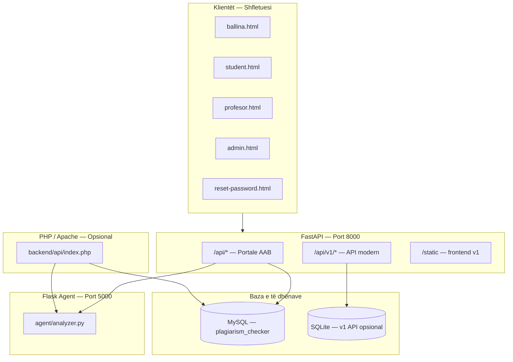
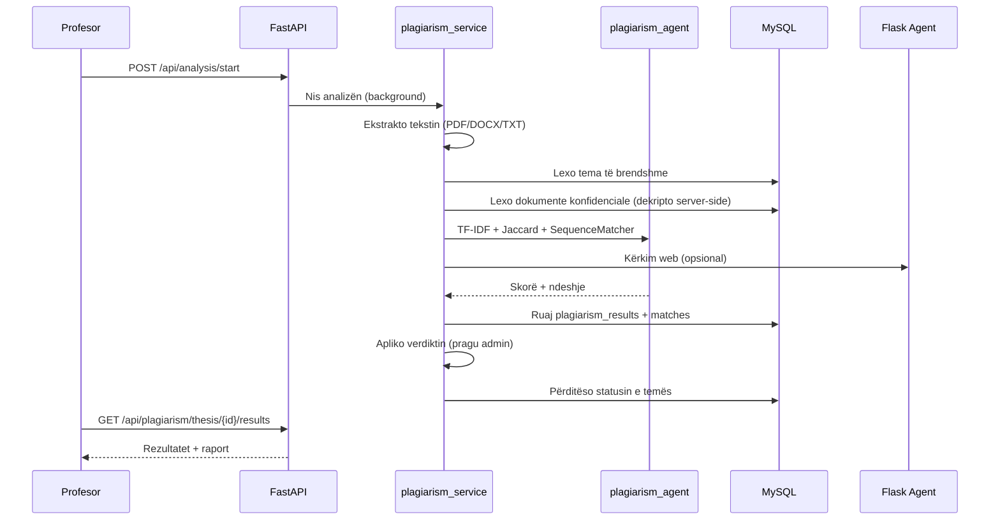

# Sistemi i Analizës së Plagjiaturës — Universiteti AAB

Platformë profesionale për zbulimin e plagjiaturës në tema diplome, e ndërtuar për **Universitetin AAB** (Fakulteti i Informatikës). Sistemi ofron portale të dedikuara për **studentë**, **profesorë** dhe **administratorë**, me analizë automatike të tekstit, raporte PDF, menaxhim temash dhe asistent AI.

**Versioni aktual:** `3.0.0`  
**Pika hyrëse kryesore:** `app/main.py` (FastAPI, port **8000**)

---

## Përmbledhje e shkurtër

| Aspekt | Detaj |
|--------|-------|
| **Qëllimi** | Analizë e plagjiaturës në tema diplome (PDF, DOCX, TXT) |
| **Institucioni** | Universiteti AAB — 6 drejtime zyrtare të Informatikës |
| **Backend** | FastAPI + SQLAlchemy + MySQL (XAMPP) |
| **Frontend** | HTML/CSS/JS (vanilla) — UI në shqip |
| **AI / NLP** | TF-IDF, Jaccard, SequenceMatcher, sentence-transformers, FAISS, LangChain |
| **Agent analize** | Flask (port **5000**) — ekstraktim, krahasim, kërkim web |
| **Autentifikim** | JWT (8 orë) + bcrypt |
| **Raportet** | ReportLab PDF + grafikë (Chart.js, matplotlib) |

---

## Arkitektura e sistemit



Sistemi kombinon **dy shtresa**:

1. **Sistemi legacy i portaleve AAB** — MySQL, workflow student–profesor–admin, UI kryesor (`ballina.html`, `student.html`, `profesor.html`, `admin.html`).
2. **API v1 modern** — SQLite/MySQL, FAISS + sentence-transformers + LangChain ReAct agent (`/api/v1/*`, `frontend/`).

`start_all.bat` nis të dyja: FastAPI (`app/main.py`) dhe Flask agent-in.

---

## Karakteristikat kryesore

### Zbulimi i plagjiaturës
- Ngarkim skedarësh: **PDF**, **DOCX**, **TXT** (maks. ~20 MB)
- Krahasim me **tema të brendshme** (tema të tjera në DB)
- Krahasim me **dokumente konfidenciale** (korpus i enkriptuar AES/Fernet — përmbajtja nuk shfaqet kurrë në frontend)
- Krahasim me **burime web** (opsional, përmes agent-it Flask)
- Rezultate me skorë: **overall**, **internal**, **confidential**, **web**
- Nivele rreziku dhe **verdikt automatik** bazuar në pragun e admin-it (default **30%**)
- Raporte PDF të gjeneruara me ReportLab
- Theksim paragrafësh të dyshimtë (`agent/nlp/highlighter.py`)

### Workflow i temës
1. Studenti regjistrohet / kyçet me email `@universitetiaab.com`
2. Zgjedh profesorin dhe departamentin
3. Ngarkon temën e diplomës
4. Profesori merr njoftim dhe shikon temën e caktuar
5. Profesori nis analizën e plagjiaturës
6. Sistemi gjeneron rezultate, ndeshje (matches) dhe raport
7. Profesori jep **review** (aprovim / refuzim / rishikim) me komente
8. Studenti shikon rezultatin pas aprovimit të profesorit

### Menaxhimi admin
- Dashboard me statistika, grafikë (Chart.js) dhe pasqyrë departamentesh
- CRUD profesorësh, studentësh, temash
- Cilësime sistemi: **pragu i plagjiaturës**, gjuha e raportit
- Dokumente konfidenciale (upload, arkivim, statistika)
- Sinkronizim arkivi **`Temat/`** → baza e të dhënave
- Asistent AI i bazuar në statistika live të DB-së
- Fshirje përdoruesish dhe deaktivim llogarish

### Siguria dhe autentifikimi
- Fjalëkalime me **bcrypt**
- Token **JWT** (HS256, TTL **8 orë**)
- Rregulla email sipas rolit (shiko më poshtë)
- **Rivendosje fjalëkalimi** me token (TTL 60 min) — SMTP ose log dev (`logs/password_reset.log`)
- Kontroll aksesi: studenti sheh vetëm temat e veta; profesori vetëm temat e caktuara; admin sheh gjithçka
- Token të veçantë në localStorage: `stu_token`, `prof_token`, `admin_token` (lejon role të ndryshme në tab-a të ndryshëm)

### Departamentet (Fakulteti i Informatikës)

**Profesorët** — një departament i vetëm: **Shkenca Kompjuterike** (`departments.py`, API `?for=professor`).

**Studentët** — 6 drejtime / specializime (API `?for=student`):
1. Programim
2. Programim dhe AI
3. Programim dhe Multimedia
4. Programim i Lojërave Kompjuterike
5. Siguri Kibernetike
6. Specializim në Inxhinieri Softuerike

Departamenti i temës merret nga **drejtimi i studentit** (jo nga profesori), i ruajtur në `theses.department`.

### Asistentët AI
| Komponent | Përdorimi |
|-----------|-----------|
| `routers/agent_helpers.py` | Chat admin/profesor — përgjigje nga statistikat e DB-së |
| `app/agent/agent.py` | LangChain ReAct + HuggingFace `google/flan-t5-base` (API v1) |
| `plagiarism_agent.py` | Motor kryesor analize: TF-IDF, Jaccard, web search |
| `advanced_ai_agent.py` | Hybrid semantic + TF-IDF (teste, jo i lidhur me router-at) |
| `agent/main.py` | Flask agent — pipeline i plotë analize (port 5000) |
| `backend/chatbot/chatbot.php` | Chatbot me keyword (PHP, opsional) |

---

## Rolet dhe portalet

### Studenti — `student.html`
- **Email:** duhet të përfundojë me `@universitetiaab.com`
- Regjistrim, kyçje, ndryshim fjalëkalimi
- Zgjedhje profesori dhe departamenti
- Ngarkim teme diplome
- Shikim statusi analize dhe rezultati (pas review)

### Profesori — `profesor.html`
- **Email:** domeni duhet të jetë saktësisht `aab-edu.net` (p.sh. `emri@aab-edu.net`)
- Dashboard: tema gjithsej, të flamëruara, % mesatare ngjashmërie
- Lista e temave të caktuara
- Nisje analize plagjiature
- Review (aprovim / refuzim / rishikim) me komente
- Njoftime për tema të reja
- Asistent AI
- Ngarkim dhe analizë direkte e skedarëve

### Administratori — `admin.html` + `admin_temat.js`
- **Llogaria admin:** `admin` — fjalëkalimi vendoset me `ADMIN_PASSWORD` (i detyrueshëm kur `ENV=production`)
- Dashboard, raporte & statistika
- Menaxhim profesorësh, studentësh, temash
- Cilësime sistemi (pragu plagjiature, etj.)
- Dokumente konfidenciale
- Asistent AI
- Sinkronizim folderi `Temat/`

### Faqja kryesore — `ballina.html`
- Landing page publike me logo AAB
- Modal kyçje/regjistrim për të tre rolet
- "Keni harruar fjalëkalimin?" → rivendosje
- Ridrejtim automatik sipas rolit pas login-it

### Faqe të tjera
| Skedar | Qëllimi |
|--------|---------|
| `reset-password.html` | Formular rivendosje fjalëkalimi (token nga email) |
| `frontend/index.html` | UI v1 — upload, listë dokumentesh, check FAISS, chat LangChain |
| `templates/ballina.html` | Variant/template i faqes kryesore |

---

## Stack teknologjik

### Backend (Python)
- **FastAPI** 0.111+ — API REST, OpenAPI docs
- **Uvicorn** — ASGI server
- **SQLAlchemy** 2.x — ORM
- **Alembic** — migrime (tabela v1)
- **PyMySQL** — lidhje MySQL
- **PyJWT + bcrypt** — autentifikim
- **Pydantic Settings** — konfigurim `.env`

### NLP / ML
- **scikit-learn** — TF-IDF, cosine similarity
- **NLTK** — stopwords, stemming
- **sentence-transformers** — embedding semantik
- **FAISS** — kërkim vektorësh (API v1)
- **LangChain** — ReAct agent me model lokal HuggingFace
- **transformers** — modele NLP

### Ekstraktim teksti
- **pypdf / PyPDF2** — PDF
- **python-docx** — DOCX
- **pdfplumber** — PDF (agent Flask)

### Raporte & vizualizim
- **ReportLab** — PDF
- **matplotlib / seaborn** — grafikë server-side
- **Chart.js** — grafikë në portale (admin, profesor)

### Frontend
- HTML5, CSS3, JavaScript (vanilla)
- Pa Node.js / npm — zero build step
- CSS të dedikuar: `admin.css`, `student.css`, `profesor.css`

### Baza e të dhënave
- **MySQL** (XAMPP) — baza kryesore `plagiarism_checker`
- **SQLite** — opsional për API v1 (`data/plagiarism_checker.db`)

### Opsional
- **PHP** (`backend/`) — API alternative përmes Apache/XAMPP
- **Flask** (`agent/`) — microservice analize (port 5000)
- **Django REST** (`detector/`) — stack legacy, nuk niset nga `start_all.bat`

---

## Struktura e projektit

```
Plagiarism_checker/
├── app/                          # Aplikacioni FastAPI v3 (pika hyrëse)
│   ├── main.py                   # Entry point — portale + API v1
│   ├── config.py                 # Settings nga .env
│   ├── legacy_bootstrap.py       # Bootstrap admin default
│   ├── api/v1/                   # API modern (documents, checks, agent)
│   ├── agent/                    # LangChain ReAct agent
│   ├── database/                 # Engine v1 + Alembic migrations
│   ├── models/                   # ORM v1 (Document, CheckResult, User)
│   ├── repositories/             # Data access layer
│   ├── schemas/                  # Pydantic DTO
│   └── services/                 # Plagiarism service FAISS
│
├── routers/                      # Router-at e portaleve AAB
│   ├── auth_router.py            # Login, register, password reset
│   ├── theses.py                 # Ngarkim dhe menaxhim temash
│   ├── analysis.py               # Nisje analize
│   ├── plagiarism_router.py      # Rezultate plagjiature
│   ├── admin_dashboard.py        # Dashboard admin
│   ├── admin_theses.py           # Menaxhim temash admin
│   ├── admin_professors.py       # CRUD profesorësh
│   ├── admin_settings.py         # Cilësime sistemi
│   ├── admin_agent.py            # AI assistant admin
│   ├── professor_agent.py        # AI assistant profesor
│   ├── portals.py                # Endpoints student/professor
│   ├── confidential_docs.py      # Dokumente konfidenciale
│   ├── notifications.py          # Njoftime
│   ├── thesis_interactions.py    # Review i profesorit
│   ├── reports.py                # Gjenerim raportesh PDF
│   └── departments_router.py     # Lista departamentesh
│
├── services/                     # Logjikë biznesi
│   ├── plagiarism_service.py     # Orkestrim analize
│   ├── admin_settings_service.py # Lexim/shkrim cilësimesh
│   ├── password_reset.py         # Rivendosje fjalëkalimi
│   ├── email_service.py          # SMTP
│   ├── thesis_delete.py          # Fshirje temash
│   ├── legacy_table_cleanup.py   # Heq tabela/kolona legacy në startup
│   └── temat_archive.py          # Sinkronizim Temat/
│
├── agent/                        # Flask agent (port 5000)
│   ├── main.py
│   ├── analyzer.py
│   ├── extractors/               # PDF, DOCX
│   ├── nlp/                      # Similarity, highlighter
│   └── web_search/               # Kërkim web + verifikim
│
├── backend/                      # PHP API (Apache/XAMPP)
│   ├── api/index.php, handlers.php
│   ├── lib/Auth.php, AgentClient.php, departments.php
│   ├── chatbot/chatbot.php
│   └── config/config.php, database.php
│
├── frontend/                     # UI v1 (FAISS/LangChain)
│   ├── index.html
│   ├── js/app.js
│   └── css/style.css
│
├── Portale HTML (root)
│   ├── ballina.html              # Faqja kryesore
│   ├── student.html              # Portali studentit
│   ├── profesor.html             # Portali profesorit
│   ├── admin.html                # Paneli admin
│   ├── reset-password.html
│   ├── admin_temat.js            # Logjika JS e admin panelit
│   ├── admin.css, student.css, profesor.css
│
├── Motorë analize (Python root)
│   ├── plagiarism_agent.py       # Motor aktiv TF-IDF/Jaccard
│   ├── ai_agent.py               # Motor alternativ NLTK
│   ├── advanced_ai_agent.py      # Hybrid semantic + TF-IDF
│   ├── rag_agent.py              # RAG wrapper
│   ├── plagiarism_service.py     # Orkestrim legacy
│   ├── document_processor.py     # Procesim dokumentesh
│   ├── text_extractor.py         # Ekstraktim teksti
│   ├── report_generator.py       # PDF reports
│   └── confidential.py           # Enkriptim AES/Fernet
│
├── schema.sql                    # DDL MySQL (13 tabela core)
├── database/schema.sql           # Kopje e schema.sql
├── models.py                     # ORM legacy (MySQL)
├── database.py                   # Engine legacy + migrime runtime
├── auth.py                       # JWT, bcrypt, guards
├── auth_email.py                 # Rregullat e email-it
├── departments.py                # Departamentet zyrtare AAB
├── access_control.py             # Kontroll aksesi temash
│
├── Temat/                        # Tema shembull (PDF/DOCX) për arkiv
├── uploads/                      # Skedarë të ngarkuar
├── reports/                      # Raporte të gjeneruara
├── logs/                         # Log aplikacioni, password reset
├── data/                         # SQLite v1, FAISS index
│
├── tests/                        # Pytest
├── scripts/                      # Backfill, e2e, db upgrade
├── requirements.txt
├── agent/requirements.txt
├── alembic.ini
├── .env.example
├── start_all.bat                 # Nisja e plotë (rekomandohet)
├── start.bat                     # Alias për start_all.bat
└── start_agent.bat               # Vetëm Flask agent
```

---

## Skema e bazës së të dhënave (MySQL)

**Emri:** `plagiarism_checker` (utf8mb4)

### Tabelat core (13)

| # | Tabela | Përshkrimi |
|---|--------|------------|
| 1 | `users` | Përdoruesit (admin, professor, student) |
| 2 | `professors` | Profile profesorësh |
| 3 | `students` | Profile studentësh |
| 4 | `theses` | Temat e diplomave |
| 5 | `uploaded_files` | Skedarët e ngarkuar (1:1 me thesis) |
| 6 | `notifications` | Njoftime për profesorë |
| 7 | `reviews` | Review i profesorit mbi temën |
| 8 | `confidential_documents` | Korpus konfidencial (i enkriptuar) |
| 9 | `plagiarism_results` | Rezultatet e analizës |
| 10 | `plagiarism_matches` | Ndeshjet e gjetura (internal/confidential/web) |
| 11 | `reports` | Raporte të gjeneruara |
| 12 | `system_settings` | Cilësimet e panelit admin |
| 13 | `password_reset_tokens` | Token rivendosje fjalëkalimi |

### Tabela legacy (instalime të vjetra)

Në skemën e re **nuk krijohen**. Në DB ekzistuese hiqen automatikisht në startup (`services/legacy_table_cleanup.py`):

`universities`, `topic_requests`, `thesis_messages`, `thesis_feedback`, `thesis_evaluations`

### Marrëdhëniet kryesore

```
users ──┬── professors ──┬── theses (assigned_professor_id)
        │                ├── notifications
        │                └── reviews
        └── students ────── theses (student_id)
                              ├── uploaded_files
                              ├── plagiarism_results ── plagiarism_matches
                              └── reports
confidential_documents ←── plagiarism_matches (conf_source_id)
system_settings (group_name + setting_key — unik)
password_reset_tokens → users
```

### Enum-et kryesore
- `users.role`: `admin` | `professor` | `student`
- `theses.status`: `pending` | `analyzing` | `completed` | `flagged`
- `theses.workflow_status`: `in_process` | `approved` | `rejected` | `needs_revision`
- `plagiarism_matches.source_type`: `confidential` | `internal` | `web`

### Tabelat v1 (Alembic — prefix `v1_`)
- `v1_users`, `v1_documents`, `v1_check_results` — të ndara nga skema legacy e portaleve

---

## API — Endpoint-et

**Dokumentacioni interaktiv:** [http://127.0.0.1:8000/docs](http://127.0.0.1:8000/docs)

### Faqe statike
| Metoda | Rruga | Përshkrimi |
|--------|-------|------------|
| GET | `/`, `/ballina.html` | Faqja kryesore |
| GET | `/student.html` | Portali studentit |
| GET | `/profesor.html` | Portali profesorit |
| GET | `/admin.html` | Paneli admin |
| GET | `/reset-password.html` | Rivendosje fjalëkalimi |
| GET | `/health` | Health check + statistika DB |

### Autentifikim — `/api/auth`
| Metoda | Rruga | Auth | Përshkrimi |
|--------|-------|------|------------|
| POST | `/api/auth/login` | — | Kyçje (username ose email) |
| POST | `/api/auth/register` | — | Regjistrim student/profesor |
| GET | `/api/auth/me` | JWT | Përdoruesi aktual |
| POST | `/api/auth/forgot-password` | — | Kërko rivendosje |
| GET | `/api/auth/reset-password/validate` | — | Valido token |
| POST | `/api/auth/reset-password` | — | Vendos fjalëkalim të ri |
| POST | `/api/auth/change-password` | JWT | Ndrysho fjalëkalimin |
| POST | `/api/auth/users` | Admin | Krijo përdorues |
| GET | `/api/auth/users` | Admin | Listo përdoruesit |
| DELETE | `/api/auth/users/{id}` | Admin | Fshi përdorues |
| PATCH | `/api/auth/users/{id}/deactivate` | Admin | Deaktivizo |

### Temat — `/api/theses`
| Metoda | Rruga | Përshkrimi |
|--------|-------|------------|
| GET | `/api/theses/` | Lista (e filtruar sipas rolit) |
| POST | `/api/theses/upload` | Ngarko temë |
| POST | `/api/theses/manual` | Hyrje manuale |
| GET | `/api/theses/professors-list` | Lista profesorësh |
| GET | `/api/theses/{id}` | Detaje |
| GET | `/api/theses/{id}/file` | Shkarko/shiko skedar |
| DELETE | `/api/theses/{id}` | Fshi temë |
| GET/POST | `/api/theses/{id}/review` | Review i profesorit |

### Analiza — `/api/analysis` dhe `/api/plagiarism`
| Metoda | Rruga | Përshkrimi |
|--------|-------|------------|
| POST | `/api/analysis/start` | Nis analizë (background) |
| POST | `/api/analysis/compare` | Krahaso dy tema |
| GET | `/api/analysis/result/{id}` | Rezultati |
| GET | `/api/analysis/thesis/{id}/status` | Statusi |
| POST | `/api/plagiarism/thesis/{id}/analyze` | Trigger analize |
| GET | `/api/plagiarism/thesis/{id}/results` | Rezultatet |

### Admin — `/api/admin`
| Metoda | Rruga | Përshkrimi |
|--------|-------|------------|
| GET | `/api/admin/dashboard` | Statistika dashboard |
| GET/POST | `/api/admin/settings` | Cilësimet |
| GET/POST/PUT/DELETE | `/api/admin/professors[/{id}]` | CRUD profesorësh |
| GET/PUT/DELETE | `/api/admin/theses[/{id}]` | Menaxhim temash |
| POST | `/api/admin/theses/sync-temat` | Sinkronizo `Temat/` |
| POST | `/api/admin/agent/chat` | Asistent AI |

### Të tjera
| Prefix | Endpoint-e |
|--------|------------|
| `/api/departments` | Lista departamentesh |
| `/api/confidential` | Upload, listë, arkivim dokumentesh konfidenciale |
| `/api/reports` | Gjenerim dhe shkarkim raportesh PDF |
| `/api/notifications` | Njoftime profesorësh |
| `/api/student/*` | Profesorë, tema ime, submit |
| `/api/professor/*` | Temat, analizë, AI chat |

### API v1 — `/api/v1`
| Metoda | Rruga | Përshkrimi |
|--------|-------|------------|
| POST | `/api/v1/documents/upload` | Ngarko dokument |
| GET | `/api/v1/documents/` | Listo dokumentet |
| GET | `/api/v1/documents/{id}` | Detaje |
| POST | `/api/v1/checks/run` | Analizë FAISS |
| GET | `/api/v1/checks/{id}` | Rezultati |
| GET | `/api/v1/checks/{id}/report` | Raport i detajuar |
| POST | `/api/v1/agent/chat` | Chat me LangChain agent |

### Flask Agent — port 5000
| Metoda | Rruga | Përshkrimi |
|--------|-------|------------|
| GET | `/health` | Health check |
| POST | `/agent/analyze` | Analizë e plotë e skedarit |

---

## Rrjedha e autentifikimit

```
1. Përdoruesi → POST /api/auth/login
   ├── Gjej user me username OSE email (is_active=true)
   ├── Verifiko fjalëkalimin (bcrypt)
   ├── Valido domenin e email-it sipas rolit
   ├── Përditëso last_login
   └── Kthe JWT: { sub, role, department, exp: 8h }

2. Regjistrim → POST /api/auth/register
   ├── register_as: "student" | "professor"
   ├── Valido email (@universitetiaab.com / @aab-edu.net — exact match)
   ├── Kërkohet departamenti
   ├── Krijo User + profile Professor/Student
   └── Kthe JWT menjëherë

3. Kërkesa të mbrojtura
   └── Header: Authorization: Bearer <token>

4. Rivendosje fjalëkalimi
   ├── POST /api/auth/forgot-password → token SHA-256 në DB
   ├── Email: {APP_PUBLIC_URL}/reset-password.html?token=...
   ├── Dev: logs/password_reset.log (kur SMTP mungon)
   └── POST /api/auth/reset-password → bcrypt hash i ri

5. Frontend
   ├── Token në localStorage (stu_token / prof_token / admin_token)
   └── Ridrejtim: student.html | profesor.html | admin.html
```

### Rregullat e email-it
| Roli | Rregulla |
|------|----------|
| **Student** | Email duhet të përfundojë me `@universitetiaab.com` |
| **Profesor** | Domeni duhet të jetë saktësisht `aab-edu.net` (allowlist, jo substring) |
| **Admin** | Pa kufizim domeni (default: `admin@aab.edu.al`) |

> Allowlist-i i domain-eve është në `auth_email.py` (`PROFESSOR_EMAIL_DOMAINS`). Krahasimi është
> exact match, prandaj domain-e si `evil-aab-edu.com`, `aab-edu.net.evil.com` ose `aab-edu-fake.net`
> refuzohen. `LEGACY_PROFESSOR_EMAIL_DOMAINS` mban domain-in e vjetër `aab-edu` vetëm për kyçjen e
> llogarive ekzistuese — regjistrimet e reja me të refuzohen.

---

## Si të instalohet dhe niset

### Kërkesat paraprake
- **Python** 3.10+
- **XAMPP** (MySQL) — rekomandohet
- **Git** (opsional)

### 1. Klono / hap projektin

```bash
cd Plagiarism_checker
```

### 2. Instalo varësitë Python

```bash
pip install -r requirements.txt
```

> Herën e parë shkarkohen modelet NLP (~qindra MB): sentence-transformers, HuggingFace, etj.

### 3. Konfiguro mjedisin

```bash
copy .env.example .env
```

Redakto `.env` — variablat kryesore:

| Variabli | Përshkrimi | Shembull |
|----------|------------|----------|
| `SECRET_KEY` | Çelës JWT (min. 16 karaktere) | `change-me-in-production-min-16-chars` |
| `JWT_SECRET` | Çelës JWT (legacy) | i njëjti si SECRET_KEY |
| `DATABASE_URL` | DB për API v1 | `sqlite:///./data/plagiarism_checker.db` |
| `LEGACY_DATABASE_URL` | DB për portale AAB | `mysql+pymysql://root:@127.0.0.1:3306/plagiarism_checker?charset=utf8mb4` |
| `LEGACY_ALLOW_SQLITE_FALLBACK` | Fallback SQLite nëse MySQL nuk punon | `1` |
| `APP_PUBLIC_URL` | URL publike (rivendosje fjalëkalimi) | `http://127.0.0.1:8000` |
| `SMTP_*` | Email për rivendosje fjalëkalimi | (opsional) |
| `PASSWORD_RESET_DEV_LOG` | Log lidhjet në dev | `1` |
| `AGENT_PORT` | Porti Flask agent | `5000` |

### 4. Krijo bazën e të dhënave MySQL

**Opsioni A — phpMyAdmin:**
1. Hap phpMyAdmin
2. Importo `schema.sql`

**Opsioni B — command line:**

```bash
mysql -u root < schema.sql
```

### 5. Migrime v1 (opsional)

```bash
alembic upgrade head
```

### 6. Nis aplikacionin

**Windows (rekomandohet):**

```bat
start_all.bat
```

Ky skript:
1. Nis MySQL/Apache nga XAMPP (nëse ekzistojnë)
2. Ndal proceset në portet 8000 dhe 5000
3. Nis **FastAPI** → `python -m uvicorn app.main:app --host 127.0.0.1 --port 8000 --reload`
4. Nis **Flask Agent** → `python agent\main.py` (port 5000)
5. Ekzekuton smoke test PHP (nëse ka PHP)

**Manual:**

```bash
set PYTHONPATH=%CD%
python -m uvicorn app.main:app --host 127.0.0.1 --port 8000 --reload
```

### 7. Hape në shfletues

| Faqe | URL |
|------|-----|
| **Faqja kryesore** | [http://127.0.0.1:8000/ballina.html](http://127.0.0.1:8000/ballina.html) |
| **Student** | [http://127.0.0.1:8000/student.html](http://127.0.0.1:8000/student.html) |
| **Profesor** | [http://127.0.0.1:8000/profesor.html](http://127.0.0.1:8000/profesor.html) |
| **Admin** | [http://127.0.0.1:8000/admin.html](http://127.0.0.1:8000/admin.html) |
| **API Docs** | [http://127.0.0.1:8000/docs](http://127.0.0.1:8000/docs) |
| **Health** | [http://127.0.0.1:8000/health](http://127.0.0.1:8000/health) |
| **UI v1** | [http://127.0.0.1:8000/static/](http://127.0.0.1:8000/static/) |
| **Apache (alt.)** | `http://localhost/Plagiarism_checker/ballina.html` |

### Llogaria admin

| Roli | Username | Fjalëkalimi | Email |
|------|----------|-------------|-------|
| **Admin** | `admin` | vlera e `ADMIN_PASSWORD` në `.env` | `admin@aab.edu.al` |

> Admini krijohet vetëm nëse nuk ekziston. Me `ENV=production`, `ADMIN_PASSWORD` është i detyrueshëm
> (minimumi 12 karaktere) dhe startup-i dështon nëse mungon ose është i dobët. Fjalëkalimi i një
> admini ekzistues nuk rivendoset kurrë automatikisht.
>
> Në `development`/`test`, nëse `ADMIN_PASSWORD` nuk vendoset, përdoret një fallback
> development-only i përcaktuar në `app/legacy_bootstrap.py`, i cili refuzohet në production.
> Asnjë fjalëkalim nuk ruhet në README, në skripte apo në `schema.sql`.

> Studentët dhe profesorët regjistrohen përmes faqes kryesore me email institucional.

---

## Si funksionon analiza e plagjiaturës



### Llojet e skorëve
| Skorë | Burimi |
|-------|--------|
| `overall_score` | Skorë totale e ngjashmërisë |
| `internal_score` | Krahasim me tema të tjera në DB |
| `confidential_score` | Krahasim me korpusin konfidencial |
| `web_score` | Krahasim me burime interneti (URL të verifikuara) |

### Kërkim web — burime të sakta
1. Sistemi merr **frazat e gjata** nga tema dhe i kërkon me API zyrtare (Google/Bing/Brave/Tavily).
2. **Verifikon** që fraza ekziston në faqen e URL-së (fetch i faqes + përputhje fuzzy).
3. Vetëm URL të **verifikuara në faqe** (verifikim ≥72%, overlap ≥42%) hyjnë në rezultat.
4. Vendosni **një** çelës në `.env` (mjafton një):
   - `SERPER_API_KEY` — https://serper.dev (Google, rekomandohet)
   - `BRAVE_SEARCH_API_KEY` — https://brave.com/search/api/
   - `SERPAPI_KEY` — https://serpapi.com/manage-api-key
   - `TAVILY_API_KEY` — https://tavily.com
   - `BING_SEARCH_API_KEY` — Azure Bing Search v7
5. Status: `GET /api/analysis/web-search/status`

### Verdikti automatik
- Lexohet pragu nga `system_settings` (default **30%**)
- Nëse skorë ≤ pragu → status `completed`
- Nëse skorë > pragu → status `flagged`
- Zona "mesatare" ≈ 2/3 e pragut (për UI)

---

## Backend PHP (opsional)

Projekti përfshin edhe një **API PHP** si alternativë ndaj FastAPI, i konfiguruar për Apache/XAMPP:

| Skedar | Roli |
|--------|------|
| `api/index.php` | Rewrite → `backend/api/index.php` |
| `backend/api/handlers.php` | Logjika (~1700 rreshta) — pasqyron FastAPI |
| `backend/lib/Auth.php` | JWT autentifikim |
| `backend/lib/AgentClient.php` | cURL → Flask agent `:5000` |
| `backend/chatbot/chatbot.php` | Chatbot me keyword |
| `health.php` | Health check PHP |

PHP përdor të njëjtin `JWT_SECRET` dhe bazën MySQL `plagiarism_checker`.

---

## Testet

```bash
pytest tests/ -v
```

| Skedar | Përshkrimi |
|--------|------------|
| `tests/test_plagiarism.py` | Teste motor plagjiature |
| `tests/test_agent.py` | Teste LangChain agent |
| `tests/test_integration.py` | Teste integrimi API |
| `scripts/e2e_test.py` | Test end-to-end |
| `backend/scripts/smoke_test.php` | Smoke test PHP |

---

## Folderi `Temat/` — Arkivi shembull

Përmban **PDF/DOCX** tema diplome shembull për testim dhe arkiv:
- Artificial Intelligence in Healthcare Systems
- Blockchain Technology in Financial Services
- Cloud Computing Architecture and Services
- Deep Learning for Image Recognition
- Machine Learning Techniques for Fraud Detection
- etj.

Admin mund t'i sinkronizojë me DB: **POST `/api/admin/theses/sync-temat`**

---

## Log-et dhe skedarët e gjeneruar

| Rruga | Përshkrimi |
|-------|------------|
| `logs/plagiarism.log` | Log i aplikacionit FastAPI |
| `logs/password_reset.log` | Lidhjet e rivendosjes (dev mode) |
| `uploads/` | Skedarë të ngarkuar nga përdoruesit |
| `reports/` | Raporte PDF të gjeneruara |
| `data/` | SQLite v1, indeks FAISS |
| `backend/reports/` | Raporte JSON (PHP) |

---

## Shënime për prezantim

1. **Demo live:** Hap `ballina.html` → kyçu si admin (`admin`, me fjalëkalimin nga `ADMIN_PASSWORD`) → shiko dashboard, temat, cilësimet.
2. **Workflow student:** Regjistro student me `@universitetiaab.com` → ngarko temë → profesori nis analizën.
3. **Pragu plagjiature:** Ndryshohet nga Admin → Cilësimet → ruhet në DB dhe aplikohet menjëherë.
4. **Departamentet:** Profesorët — Shkenca Kompjuterike; studentët — 6 drejtime; tema merr drejtimin e studentit.
5. **Siguria:** Dokumentet konfidenciale enkriptohen; përmbajtja nuk kthehet kurrë te klienti.
6. **Dual stack:** Portale AAB (MySQL) + API v1 (FAISS/LangChain) — të dyja nisen nga `app/main.py`.
7. **Pa API keys:** Motorët kryesorë punojnë lokal — nuk kërkohen çelësa OpenAI/Google.
8. **Rivendosje fjalëkalimi:** Funksionon pa SMTP — lidhja shfaqet në `logs/password_reset.log`.

---

## Licenca dhe autorësia

Projekt akademik — **Universiteti AAB**, Fakulteti i Informatikës.  
Sistemi i Analizës së Plagjiaturës — v3.0.0.
